<p align="center">
  
</p>

<p align="center">
  
  
  
  
</p>

---

##  Sobre o projeto

Projeto acadêmico desenvolvido com **Spring Boot** que simula um **sistema bancário**. A aplicação cadastra clientes, contas e cartões e realiza **transferências via Pix** com **regras de segurança e prevenção a fraudes**. As páginas são renderizadas com **Thymeleaf**, e os dados ficam em **MySQL** por meio do **Spring Data JPA**.

---

##  Funcionalidades

**Contas e clientes**
- Cadastro de clientes e abertura de contas
- Login de acesso à conta
- Página inicial com os dados da conta

**Cartões**
- Geração de número de cartão único, válido pelo **algoritmo de Luhn**
- Geração de CVV

**Pix e antifraude**
- Transferência entre contas, com validação de conta de origem, conta de destino e saldo
- Limite de **R$ 1.000,00** por transferência
- Confirmação extra quando há **3 ou mais transferências em 24 horas**
- Confirmação extra quando a conta recebe **mais de 10 valores idênticos**
- Alerta para **contas marcadas como suspeitas**

---

##  Arquitetura

```
src/main/java/com/example/Bradesco
├── controller   # Rotas: login, cadastro, página inicial e Pix
├── model        # Entidades: Cliente, Conta, Cartao, Transacao, ContaSuspeita, RegraLimite
├── repository   # Interfaces Spring Data JPA
└── service      # Regras de negócio (geração de cartões)

src/main/resources
├── templates    # Páginas Thymeleaf
└── static       # CSS e JavaScript
```

---

##  Identidade visual

| Cor | Hex | Uso |
|:---:|:---:|:---|
|  | `#1A75FF` | Cor principal (botões, destaques) |
|  | `#003366` | Azul escuro (cabeçalhos) |
|  | `#CC092F` | Vermelho de destaque |
|  | `#FFFFFF` | Fundos claros |

---

##  Como executar

**Pré-requisitos:** Java 21 e MySQL. O Maven Wrapper já vem no projeto.

```bash
# Clonar o repositório
git clone https://github.com/GustavoHermogenes/SpringBoot_Learning.git
cd SpringBoot_Learning

# Criar o banco de dados no MySQL
#   CREATE DATABASE bradesco;
# Ajuste usuário e senha em src/main/resources/application.properties

# Iniciar a aplicação
./mvnw spring-boot:run
```

A aplicação estará disponível em `http://localhost:8080`. As tabelas são criadas automaticamente pelo JPA (`ddl-auto=update`).

---

##  Autor

<p>
  <b>Gustavo Hermogenes</b> — Desenvolvedor Full Stack<br/><br/>
  <a href="https://github.com/GustavoHermogenes" target="_blank"></a>
  <a href="https://www.linkedin.com/in/gustavohermogenes/" target="_blank"></a>
</p>

<p align="center">
  
</p>
